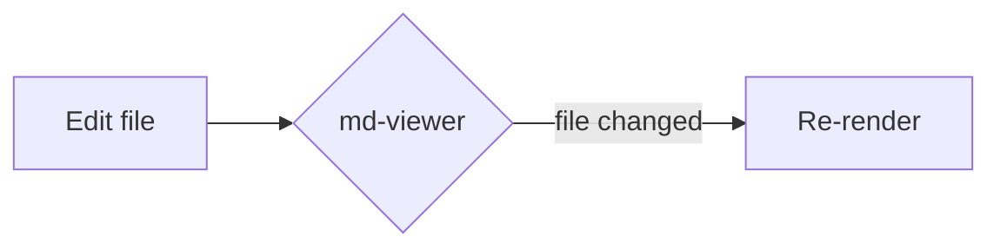

# md-viewer demo

A sample file exercising the rendering features.

## Code

```rust
fn main() {
    println!("hello, markdown");
}
```

```python
def greet(name: str) -> str:
    return f"hello, {name}"
```

## Math

Inline math: $e^{i\pi} + 1 = 0$.

Block math:

$$\int_{-\infty}^{\infty} e^{-x^2} dx = \sqrt{\pi}$$

## Mermaid



## Table

| Feature | Status |
| ------- | ------ |
| CommonMark | yes |
| KaTeX math | yes |
| Mermaid | yes |
| Live reload | yes |

> A blockquote for good measure.

Try editing this file — the viewer reloads automatically.
